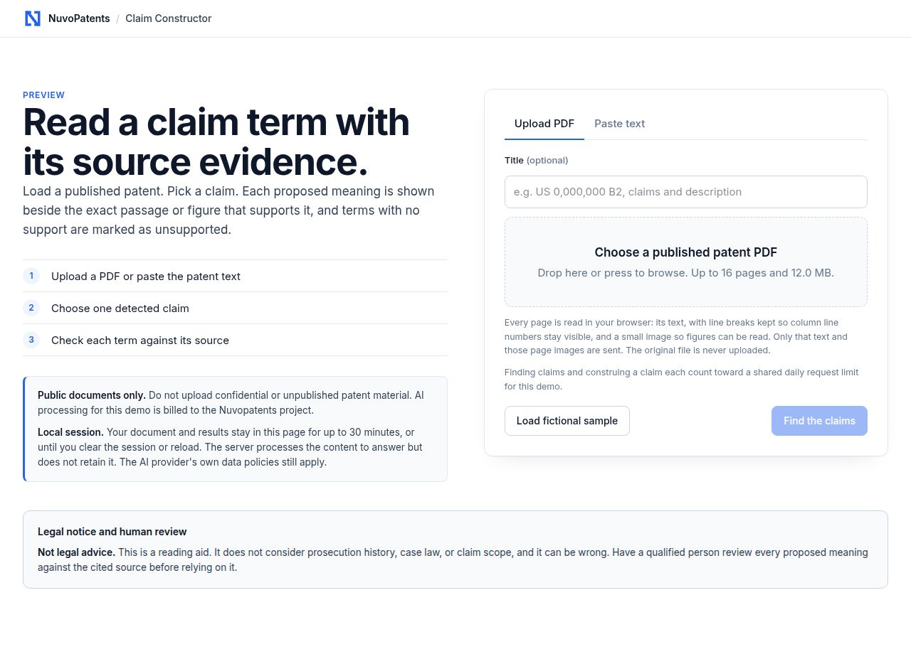
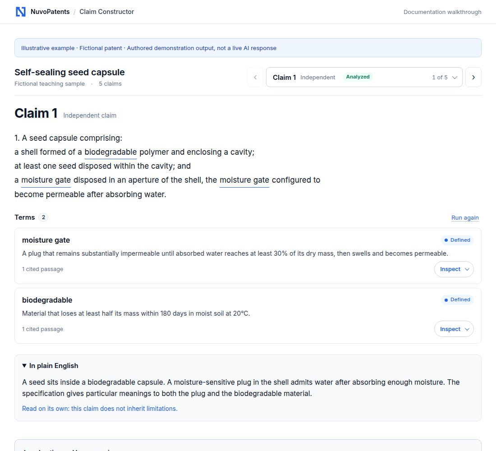
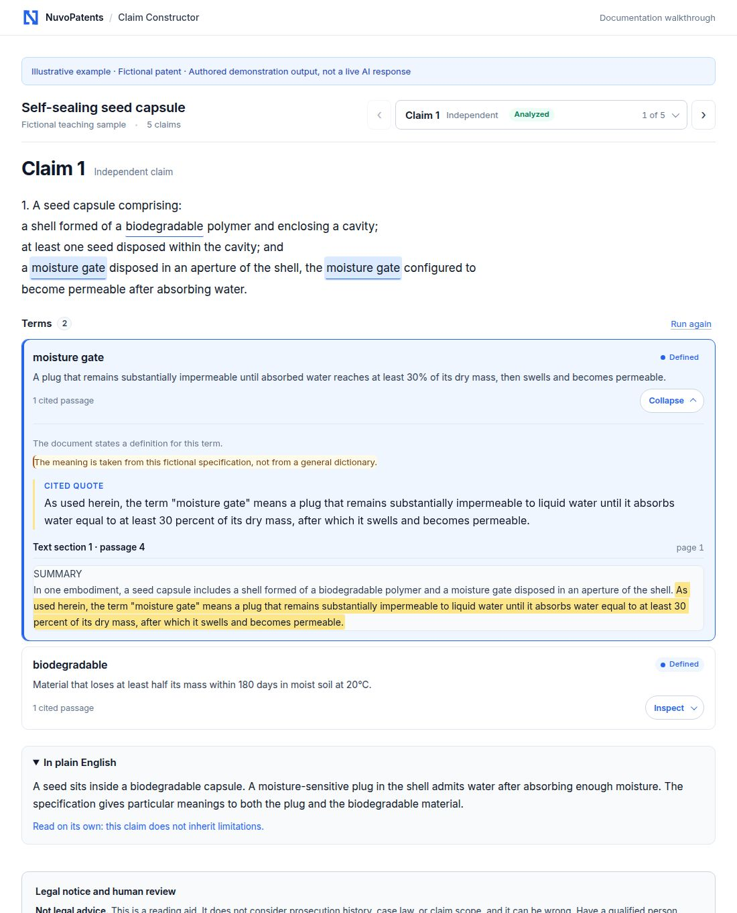
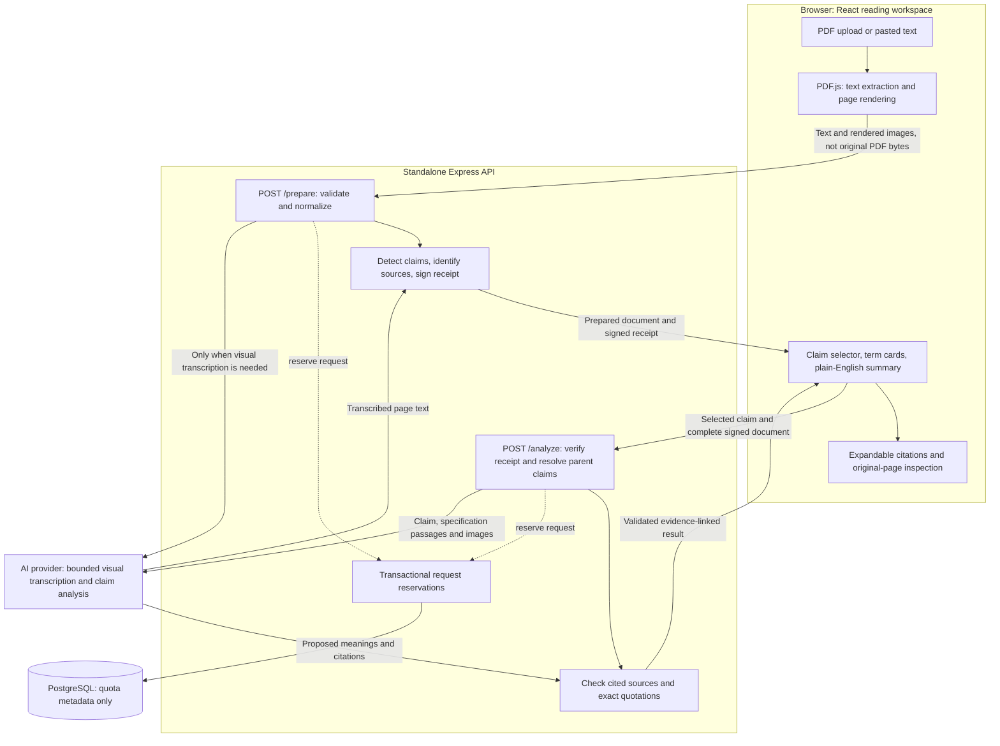

<p align="center">
  
</p>

# Patent Claim Construction AI

### NuvoPatents Claim Constructor

**Read a patent claim in the context of the patent itself—not as a list of isolated dictionary definitions.**

Upload a published patent PDF or paste its text. Choose a claim, read a plain-English explanation, and inspect the exact specification passage or original page image behind each proposed term meaning.

Built with **TypeScript, React, PDF.js, Express, PostgreSQL, and the OpenAI SDK**. Released under the **[MIT License](LICENSE)**.

[Visual walkthrough](#visual-walkthrough) · [Architecture](#architecture) · [Run locally](#run-locally) · [Code guide](#a-human-friendly-code-guide) · [Limitations](#limitations-and-responsible-use)

> **Research preview, not legal advice.** This tool proposes specification-based readings. It does not determine a binding legal construction, validity, or infringement. Inspect the cited patent evidence yourself.

## What the project demonstrates

- **Document understanding:** text PDFs, scanned pages, drawings, and pasted patent text.
- **Claim-aware reasoning:** numbered claim detection and resolution of inherited claim limitations.
- **Source-linked answers:** clickable claim terms, exact-quotation checks, and original-page inspection.
- **Honest uncertainty:** explicit, contextual, visual, and unsupported meanings are distinguished.
- **A compact reading interface:** expand a term in place instead of repeating it in a separate inspector.
- **Bounded AI requests:** fixed model, input/output limits, persistent request quotas, and no automatic provider retries.
- **Portable architecture:** the reader and analysis engine run independently of the private NuvoPatents platform.

## Visual walkthrough

### 1. Load a published patent

Choose **Upload PDF** or **Paste text**. The original PDF is opened in the browser; only extracted text and rendered page images are submitted for processing. The built-in fictional seed-capsule example offers a safe way to explore the workflow.



### 2. Select a claim and read its meaning

Choose a detected claim, then select **Construe claim**. The reader highlights interpreted terms, lists their proposed meanings, and places a collapsible plain-English explanation below the terms. Dependent claims are interpreted together with their inherited limitations.



### 3. Inspect the evidence—not just the answer

Click an underlined claim term or its **Inspect** chip. That term moves to the top and expands in place. The reader shows the proposed meaning, its evidence basis, the cited quotation, and a highlighted source passage. PDF inputs also support original-page and drawing inspection.

In this fictional example, **“moisture gate”** has an express definition in the specification: a plug that changes permeability after absorbing a stated amount of water. That is more specific than the ordinary meaning of either word.



**Screenshot provenance:** the intake image is captured from the running application. The two result images render the actual reader components using the included fictional patent and authored example interpretations. Their blue banners label them as illustrations—not live AI responses. No confidential documents or private platform screens are shown. See [the documentation fixture](docs/illustrations/walkthrough.tsx).

## Architecture



### Important boundaries

| Boundary | What happens |
| --- | --- |
| Browser → API | Extracted text and normalized page images are sent for analysis. Original PDF bytes remain in the browser. |
| API → model | Patent material is untrusted input, not system instructions. The model receives no tools or arbitrary URL-fetch capability. |
| Model → reader | Quotations must match a real source after whitespace normalization. Matching a quotation does **not** prove the proposed interpretation is correct. |
| API → PostgreSQL | Only request counts, timestamps, keyed visitor hashes, and concurrency leases are stored—not patents or results. |
| Browser session | Documents and results remain in memory, clear on reload or **Clear session**, and expire after 30 minutes. |

The two routes live under `/api/claim-constructor`. A receipt binds the prepared document to the server and an expiry; it is **not** a user identity, a one-use token, or a substitute for quotas.

## A human-friendly code guide

The code favors descriptive names, explicit request branches, small modules, strict TypeScript contracts, and comments that explain constraints rather than restating syntax.

| Start here | Responsibility |
| --- | --- |
| [`src/core/contracts.ts`](src/core/contracts.ts) | Shared schemas, domain types, and explicit input limits. |
| [`src/core/document.ts`](src/core/document.ts) | Claim detection, inherited claims, stable sources, and signed receipts. |
| [`src/core/evidence.ts`](src/core/evidence.ts) | Grounding checks and handling missing or unsupported evidence. |
| [`src/server/router.ts`](src/server/router.ts) | Validated prepare/analyze branches and safe HTTP errors. |
| [`src/server/analysis.ts`](src/server/analysis.ts) | Visual transcription and claim interpretation with bounded model calls. |
| [`src/server/quota.ts`](src/server/quota.ts) | Database-backed admission and concurrency leases across replicas. |
| [`src/ui/ClaimConstructor.tsx`](src/ui/ClaimConstructor.tsx) | Intake and reading-workspace composition. |
| [`src/ui/components/AnalysisWorkspace.tsx`](src/ui/components/AnalysisWorkspace.tsx) | Claim text, selected-first terms, inline inspection, and summary. |
| [`src/ui/session/use-claim-session.ts`](src/ui/session/use-claim-session.ts) | Session lifecycle, cancellation, progress, expiry, and recoverable errors. |
| [`standalone/server.ts`](standalone/server.ts) | Independent HTTP server and provider/database wiring. |
| [`test/`](test/) | Parsing, quotation grounding, PDF handling, quota concurrency, tampering, request boundaries, and branding regressions. |

**Suggested reading order:** contracts → document preparation → evidence validation → analysis → router → React workspace. The shared core has no dependency on Clerk, Stripe, or private platform tables.

## Run locally

### Requirements

- **Node.js 24 or newer**
- **pnpm**
- **PostgreSQL**, with a role allowed to create the demo's quota table and index
- An AI-provider configuration supported by the OpenAI SDK

```sh
git clone https://github.com/raghid-shreih/patent-claim-construction-ai.git
cd patent-claim-construction-ai
pnpm install --frozen-lockfile
cp .env.example .env
```

Configure the variables listed in `.env.example` using your local environment or hosting provider's secret manager. **Never commit a populated `.env` file.**

| Variable | Purpose |
| --- | --- |
| `OPENAI_API_KEY` | Provider credential for independent deployments. |
| `OPENAI_BASE_URL` | Optional compatible provider endpoint. |
| `DATABASE_URL` | PostgreSQL connection for quota metadata. |
| `SESSION_SECRET` | Random secret of at least 32 characters, shared by all replicas. |
| `PORT` | Optional HTTP port; defaults to `3000`. |

The server also accepts `AI_INTEGRATIONS_OPENAI_API_KEY` and `AI_INTEGRATIONS_OPENAI_BASE_URL` for an already-configured Replit AI integration. Those take precedence over the generic provider variables.

```sh
pnpm build
pnpm start
```

Open **http://localhost:3000/claim-constructor**, or your configured port. The start command loads a local `.env` file if present; hosting-injected variables also work. `pnpm dev` runs the TypeScript server against the latest built frontend—rebuild after frontend changes.

### Check the project

```sh
pnpm typecheck
pnpm test
pnpm build
```

Database-backed tests use temporary schemas and remove them afterward. They skip when `DATABASE_URL` is absent; the remaining tests do not need real AI calls. Use a dedicated development database, never production, for tests.

## Privacy, abuse controls, and costs

- **No application document archive:** server processing is request-scoped; no document database, shared result cache, or permanent analysis store.
- **Provider retention still applies:** text/images leave the browser. Only use published public material; do not submit unpublished or confidential research.
- **Input limits:** 16 pages, 12 MB original PDF, 100,000 total text characters, 20,000 per page, 800 KB per submitted JPEG, and an 18 MB HTTP body.
- **Image normalization:** page images are decoded and reduced to at most 768px on the longest side.
- **Fixed model:** `gpt-5.4-mini`, 100-second model timeout, no automatic provider retries, and completion caps of 12,000 transcription tokens or 6,500 analysis tokens.
- **Persistent admission limits:** 60 attempts per UTC calendar day globally, 10 per peer address per rolling day, 6 globally per rolling minute, and 2 active requests. Failed admitted attempts consume quota.
- **Conservative visitor identity:** the demo does not trust arbitrary forwarded-IP headers. Behind a shared proxy, unrelated visitors may share an allowance.
- **Content-free app error reporting:** event identifiers, not raw patents, model output, or provider credentials. Hosting access logs and provider policies remain separate.

**These are request limits, not a currency-denominated spending cap or a guarantee against abuse.** There is no server-enforced daily/monthly monetary ledger yet. A valid receipt can be reused within its lifetime, with each admitted call counted again. Model pricing, private workloads outside this repository, hosting, storage, and database costs are separate.

This is a portfolio research preview, not a hardened public-service release. Review and update PDF, image, validation, and HTTP-processing dependencies before an unrestricted deployment, and add ingress protection, appropriate security headers/origin controls, monitoring, and monetary budgets.

## Limitations and responsible use

- Express definitions, contextual inferences, visual evidence, and unsupported terms are labeled differently. None is a legal conclusion.
- A real quotation can still support an incorrect or incomplete interpretation. Prompt separation and schema validation cannot guarantee immunity to prompt injection.
- OCR can miss text or misread drawings, especially at low resolution.
- Claim detection needs a separate **Claims**, **What is claimed is:**, **We claim:**, or **I claim:** heading and numbered claims.
- Missing or circular parent references fail explicitly. Multiple-dependent alternatives are treated as alternatives, not automatically combined.
- Prosecution history, case law, jurisdiction-specific claim-construction rules, and external prior art are not analyzed.
- The seed-capsule example is fictional educational content, not an actual patent or application.

## Publication boundary and licensing

**This repository contains only the standalone Claim Constructor.** It excludes the private NuvoPatents dashboard, users and roles, billing, authentication, platform database schema, deployment configuration, and marketing-site code. No private platform Git history is used to publish this project.

The package name's `@workspace` prefix describes its original development location; it has no workspace-package dependencies and runs independently. `"private": true` prevents accidental npm publication—it does **not** make this GitHub repository private.

The source is [MIT-licensed](LICENSE). Keep credentials, uploads, dependency folders, generated builds, and private environment files out of commits. Brand vectors and icon exports are in [`brand-assets/`](brand-assets/README.md); the name remains real text in the UI.

For a repeatable demo-only export, run `pnpm exec tsx scripts/export-portfolio.ts /absolute/path/to/an-empty-folder`. The exporter uses an explicit file/directory allowlist, rejects symlinks, checks for private workspace imports and common credential patterns, and writes a checksum manifest outside the export. Review that manifest before publishing; a pattern scan is not a guarantee that all possible secrets can be detected.

No production demo URL is asserted here until a live deployment has been verified.
